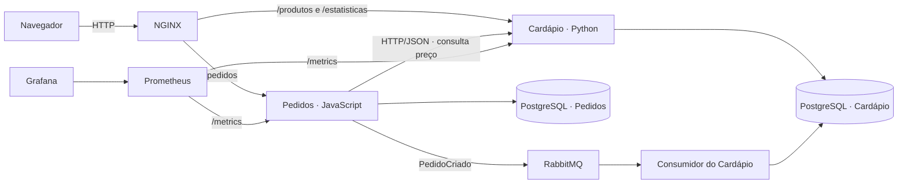

# FoodFlow

Sistema Distribuído de Gerenciamento de Pedidos para Restaurantes.

## Integrantes

- Luis Henrique Gonzaga Botelho
- Pedro Rodrigues Rocha

## 1. Sobre o projeto

O FoodFlow é uma aplicação web desenvolvida como trabalho prático da disciplina de Computação Distribuída, do curso de Sistemas de Informação da Universidade Federal de Mato Grosso do Sul (UFMS).

O projeto tem como objetivo demonstrar conceitos de arquitetura de microsserviços, heterogeneidade tecnológica, descentralização de dados, comunicação entre serviços, conteinerização, API Gateway, observabilidade e mensageria assíncrona.

A aplicação simula o gerenciamento de um restaurante, permitindo cadastrar produtos, criar pedidos, acompanhar seu andamento e consultar estatísticas dos produtos solicitados.

## 2. Tecnologias utilizadas

| Tecnologia | Finalidade |
|---|---|
| Python + FastAPI | Microsserviço de Cardápio |
| JavaScript + Node.js + Express | Microsserviço de Pedidos |
| PostgreSQL | Persistência de dados |
| Docker | Conteinerização |
| Docker Compose | Orquestração dos contêineres |
| NGINX | API Gateway e servidor do frontend |
| HTML, CSS e JavaScript | Interface web |
| RabbitMQ | Mensageria assíncrona |
| Prometheus | Coleta de métricas |
| Grafana | Visualização das métricas |

## 3. Arquitetura do sistema

O FoodFlow utiliza dois microsserviços principais, desenvolvidos em linguagens diferentes.



### Microsserviço de Cardápio

Desenvolvido em Python utilizando FastAPI.

Responsabilidades:

- Cadastrar produtos.
- Listar produtos.
- Consultar produtos pelo identificador.
- Atualizar informações e disponibilidade.
- Excluir produtos.
- Disponibilizar dados para o serviço de Pedidos.
- Consultar estatísticas dos produtos solicitados.

Esse microsserviço utiliza exclusivamente seu banco PostgreSQL, denominado `cardapio_db`.

### Microsserviço de Pedidos

Desenvolvido em JavaScript utilizando Node.js e Express.

Responsabilidades:

- Criar pedidos.
- Listar pedidos.
- Consultar pedidos pelo identificador.
- Atualizar o status dos pedidos.
- Excluir pedidos.
- Consultar preços e disponibilidade no serviço de Cardápio.
- Calcular o valor total.
- Publicar eventos no RabbitMQ.

Esse microsserviço utiliza exclusivamente seu banco PostgreSQL, denominado `pedidos_db`.

### Comunicação síncrona

Quando um pedido é realizado, o microsserviço de Pedidos consulta o microsserviço de Cardápio por HTTP/REST.

Essa comunicação permite verificar se os produtos existem, se estão disponíveis e quais são seus preços.

O valor total do pedido é calculado utilizando os preços retornados pelo Cardápio.

### Comunicação assíncrona

O serviço de Pedidos grava o pedido e o evento `PedidoCriado` na mesma operação no PostgreSQL. Uma rotina de publicação lê os eventos pendentes (*outbox*) e envia ao RabbitMQ. Se o broker estiver indisponível, o evento continua pendente para nova tentativa.

Um consumidor Python independente recebe esse evento e registra estatísticas no banco do Cardápio.

Caso o consumidor esteja temporariamente indisponível, mensagens persistentes podem permanecer na fila para processamento posterior.

## 4. Funcionalidades

### Gerenciamento de produtos

- Cadastro de produtos.
- Listagem do cardápio.
- Atualização de nome, descrição e preço.
- Controle de disponibilidade.
- Exclusão de produtos.

### Gerenciamento de pedidos

- Criação de pedidos com múltiplos produtos.
- Consulta de pedidos cadastrados.
- Cálculo automático do total.
- Atualização do status.
- Exclusão de pedidos.

Os status disponíveis são:

- Pendente.
- Em preparo.
- Pronto.
- Entregue.
- Cancelado.

### Estatísticas

O sistema registra estatísticas de produtos solicitados a partir dos eventos processados pelo consumidor RabbitMQ.

### Observabilidade

O Prometheus coleta métricas HTTP das duas APIs.

As métricas podem ser consultadas no Prometheus e visualizadas no Grafana, permitindo acompanhar:

- Quantidade de requisições.
- Códigos de resposta HTTP.
- Tempo de resposta.
- Disponibilidade dos serviços.

## 5. Requisitos para execução

É necessário possuir:

- Git.
- Docker Desktop ou Docker Engine.
- Docker Compose.
- Navegador web.

No Windows, recomenda-se utilizar Docker Desktop com contêineres Linux e WSL 2.

Não é necessário instalar Python, Node.js ou PostgreSQL diretamente no computador, pois esses componentes serão executados em contêineres Docker.

O computador também precisa ter conexão com a internet na primeira execução para baixar as imagens e dependências necessárias.

## 6. Instalação e execução

### Passo 1 - Clonar o repositório

Abra um terminal e execute:

```bash
git clone https://github.com/LuisgBotelho/testetrab.git
cd testetrab
```

### Passo 2 - Configurar as variáveis de ambiente

O Compose já tem valores para a demonstração local, espelhados no `.env.example`. Para personalizá-los, copie `.env.example` para `.env` antes da primeira subida. O Git ignora o `.env`.

### Passo 3 - Verificar o Docker

Execute:

```bash
docker --version
```

```bash
docker compose version
```

Verifique se o Docker Engine está funcionando:

```bash
docker info
```

### Passo 4 - Iniciar a aplicação

Na raiz do projeto, execute:

```bash
docker compose up --build --wait --wait-timeout 240
```

Esse comando construirá as imagens dos microsserviços e iniciará os demais componentes da arquitetura.

Na primeira execução, o processo pode demorar alguns minutos devido ao download das imagens e à instalação das dependências.

### Passo 5 - Verificar os contêineres

Execute:

```bash
docker compose ps
```

Os seguintes serviços deverão estar em execução:

- cardapio-db
- pedidos-db
- cardapio-service
- pedidos-service
- gateway
- prometheus
- grafana
- rabbitmq
- cardapio-consumer

### Passo 6 - Validar as funções

Na interface, crie um produto disponível e faça um pedido com duas unidades. Confirme o preço total, atualize o status e verifique o item na aba Estatísticas. A atualização das estatísticas pode levar alguns segundos.

Para validar automaticamente os dois CRUDs, a entrega do evento e as métricas coletadas pelo Prometheus, execute com Python 3 na raiz do clone:

```bash
python testes/smoke.py
```

No Windows, `py -3 testes/smoke.py` é uma alternativa quando o Python está disponível pelo launcher. Em uma pilha local dedicada, acrescente `--testar-retentativa` para parar o RabbitMQ brevemente e verificar que um pedido feito durante a interrupção chega às estatísticas após a volta do broker. Se iniciou o Compose com um nome de projeto personalizado, use o mesmo nome em `COMPOSE_PROJECT_NAME` ao rodar esse teste.

O teste básico também pode rodar no Python que já vem no contêiner:

```bash
docker compose cp testes/smoke.py cardapio-service:/tmp/foodflow-smoke.py
docker compose exec -T cardapio-service python /tmp/foodflow-smoke.py --gateway http://gateway --prometheus http://prometheus:9090
```

## 7. Endereços da aplicação

| Serviço | Endereço |
|---|---|
| FoodFlow - Interface Web | http://localhost:8080 |
| Prometheus | http://localhost:9090 |
| Grafana | http://localhost:3001 |
| RabbitMQ Management | http://localhost:15672 |

O NGINX centraliza o acesso às APIs pela porta 8080.

### Acesso ao Grafana

Usuário inicial:

```text
admin
```

Senha padrão da demonstração: `grafana-local`. O valor pode ser configurado em `GRAFANA_ADMIN_PASSWORD`.

### Acesso ao RabbitMQ

Usuário `foodflow` e senha `rabbitmq-local` na configuração padrão. Ajuste `RABBITMQ_USER` e `RABBITMQ_PASSWORD` para personalizar.

As credenciais iniciais são aplicadas quando os respectivos serviços são configurados pela primeira vez com volumes novos.

## 8. Endpoints da API

### Cardápio

| Método | Endpoint | Descrição |
|---|---|---|
| GET | /produtos | Listar produtos |
| GET | /produtos/{id} | Buscar produto |
| POST | /produtos | Cadastrar produto |
| PUT | /produtos/{id} | Atualizar produto |
| DELETE | /produtos/{id} | Excluir produto |
| GET | /estatisticas | Consultar estatísticas |

### Pedidos

| Método | Endpoint | Descrição |
|---|---|---|
| GET | /pedidos | Listar pedidos |
| GET | /pedidos/{id} | Buscar pedido |
| POST | /pedidos | Cadastrar pedido |
| PUT | /pedidos/{id} | Atualizar status |
| DELETE | /pedidos/{id} | Excluir pedido |

As requisições devem ser realizadas pelo API Gateway:

```text
http://localhost:8080
```

## 9. Exemplos de utilização

Os exemplos `curl` com `\` como quebra de linha podem ser executados em Bash ou Git Bash. A interface web também permite executar esses passos diretamente no navegador.

### Cadastrar um produto

```bash
curl -X POST http://localhost:8080/produtos \
  -H "Content-Type: application/json" \
  -d '{
    "nome": "Pizza de Calabresa",
    "descricao": "Pizza grande com calabresa e queijo",
    "preco": 45.90,
    "disponivel": true
  }'
```

### Consultar produtos

```bash
curl http://localhost:8080/produtos
```

### Cadastrar um pedido

Antes de executar, verifique o identificador de um produto cadastrado e disponível.

```bash
curl -X POST http://localhost:8080/pedidos \
  -H "Content-Type: application/json" \
  -d '{
    "cliente": "Pedro",
    "itens": [
      {
        "produto_id": 1,
        "quantidade": 2
      }
    ]
  }'
```

O preço não precisa ser informado.

O microsserviço Node.js consulta o FastAPI para obter o preço oficial e calcular o valor total.

### Consultar pedidos

```bash
curl http://localhost:8080/pedidos
```

### Atualizar o status

Substitua o ID pelo identificador de um pedido existente.

```bash
curl -X PUT http://localhost:8080/pedidos/1 \
  -H "Content-Type: application/json" \
  -d '{"status": "em preparo"}'
```

### Consultar estatísticas

```bash
curl http://localhost:8080/estatisticas
```

## 10. Persistência de dados

Cada microsserviço utiliza uma instância PostgreSQL independente.

Os dados são armazenados em volumes Docker.

Para verificar o banco do Cardápio:

```bash
docker compose exec cardapio-db \
  psql -U cardapio_user -d cardapio_db \
  -c "SELECT * FROM produtos;"
```

Para verificar o banco de Pedidos:

```bash
docker compose exec pedidos-db \
  psql -U pedidos_user -d pedidos_db \
  -c "SELECT * FROM pedidos;"
```

Para comprovar persistência, cadastre um produto e um pedido, guarde os IDs e execute `docker compose down` seguido de `docker compose up --wait --wait-timeout 240`. Consulte novamente os mesmos IDs pelo gateway. Os dois bancos montam seus respectivos volumes ao serem recriados.

Não execute `docker compose down -v` caso deseje preservar os dados, pois essa opção remove os volumes associados ao projeto.

## 11. Observabilidade

As duas APIs disponibilizam métricas no endpoint interno `/metrics`.

O Prometheus coleta essas informações periodicamente.

Para verificar os serviços monitorados, acesse:

http://localhost:9090/targets

Os alvos `cardapio` e `pedidos` deverão aparecer como UP quando estiverem disponíveis.

### Exemplos de consultas PromQL

Disponibilidade:

```promql
up
```

Requisições por segundo:

```promql
sum by (job) (rate(http_requests_total[1m]))
```

Erros HTTP:

```promql
sum by (job, status) (
  increase(http_requests_total{status=~"4..|5.."}[5m])
)
```

Tempo médio de resposta:

```promql
sum by (job) (
  rate(http_request_duration_seconds_sum[1m])
)
/
sum by (job) (
  rate(http_request_duration_seconds_count[1m])
)
```

### Painel do Grafana

Abra o [painel FoodFlow](http://localhost:3001/d/foodflow). A fonte Prometheus e o painel são provisionados automaticamente. Gere tráfego nas rotas de produtos e pedidos e aguarde a próxima coleta para visualizar os dados.

## 12. Mensageria com RabbitMQ

O RabbitMQ é utilizado para a comunicação assíncrona entre o microsserviço de Pedidos e o consumidor Python.

Quando a API responde `201` com `evento_agendado: true`, o pedido e o evento já estão registrados. A publicação e o consumo acontecem em segundo plano.

A fila utilizada é:

```text
pedidos_criados
```

O consumidor processa as mensagens e registra estatísticas no banco do Cardápio.

### Verificar os logs do consumidor

```bash
docker compose logs -f cardapio-consumer
```

### Testar a comunicação assíncrona

Interrompa o consumidor:

```bash
docker compose stop cardapio-consumer
```

Crie um novo pedido pela interface ou API.

A mensagem poderá permanecer aguardando na fila RabbitMQ.

Reinicie o consumidor:

```bash
docker compose start cardapio-consumer
```

O consumidor deverá processar a mensagem pendente e atualizar as estatísticas.

O publicador confirma a entrega ao broker antes de marcar o evento como publicado. O consumidor confirma a mensagem depois de atualizar o banco e reconhece reentregas pelo identificador do evento para evitar dupla contagem. A estatística representa o histórico de itens solicitados, inclusive quando o pedido é cancelado ou excluído posteriormente.

## 13. Logs e diagnóstico

Para verificar os serviços:

```bash
docker compose ps
```

Para consultar os logs do FastAPI:

```bash
docker compose logs --tail=50 cardapio-service
```

Para consultar os logs do Node.js:

```bash
docker compose logs --tail=50 pedidos-service
```

Para consultar os logs do RabbitMQ:

```bash
docker compose logs --tail=50 rabbitmq
```

Para consultar os logs do consumidor:

```bash
docker compose logs --tail=50 cardapio-consumer
```

## 14. Encerrar a aplicação

Para interromper e remover os contêineres, preservando os volumes:

```bash
docker compose down
```

Para iniciar novamente:

```bash
docker compose up -d
```

## 15. Organização do projeto

```text
foodflow/
│
├── cardapio-service/
│   ├── main.py
│   ├── database.py
│   ├── init_db.py
│   ├── metrics.py
│   ├── consumidor.py
│   ├── requirements.txt
│   └── Dockerfile
│
├── pedidos-service/
│   ├── server.js
│   ├── database.js
│   ├── init-db.js
│   ├── cardapio.js
│   ├── mensageria.js
│   ├── metrics.js
│   ├── package.json
│   ├── package-lock.json
│   └── Dockerfile
│
├── frontend/
│   ├── index.html
│   ├── style.css
│   └── script.js
│
├── nginx/
│   └── nginx.conf
│
├── prometheus/
│   └── prometheus.yml
│
├── grafana/
│   ├── dashboards/
│   └── provisioning/
│
├── testes/
│   └── smoke.py
│
├── docker-compose.yml
├── .env.example
├── .gitignore
└── README.md
```

## 16. Requisitos acadêmicos atendidos

O projeto contempla:

- Dois microsserviços em linguagens diferentes.
- CRUD completo nos dois serviços.
- Bancos de dados independentes.
- Conteinerização com Docker.
- Orquestração com Docker Compose.
- API Gateway com NGINX.
- Comunicação REST/HTTP com JSON.
- Observabilidade com Prometheus e Grafana.
- Mensageria assíncrona com RabbitMQ.
- Repositório público com código-fonte e documentação.

## 17. Apresentação

1. **Contexto e arquitetura.** Mostrem como o Cardápio concentra os dados de produtos e preços e como Pedidos registra o histórico. Sigam o diagrama desde o navegador até os dois bancos, incluindo a consulta HTTP, a fila e as métricas.
2. **Subida e CRUDs.** Partam de um clone limpo. Mostrem a subida pelo Compose. Criem, consultem e alterem um produto e um pedido. Reservem as exclusões para depois de verificar a persistência.
3. **Persistência e telemetria.** Recriem os contêineres preservando os volumes e consultem os mesmos registros. Mostrem os alvos no Prometheus e os dados no painel Grafana.
4. **Mensageria.** Parem apenas o `cardapio-consumer`, criem outro pedido e confiram a fila na interface do RabbitMQ. Iniciem o consumidor e mostrem que Estatísticas passa a incluir as novas unidades.
